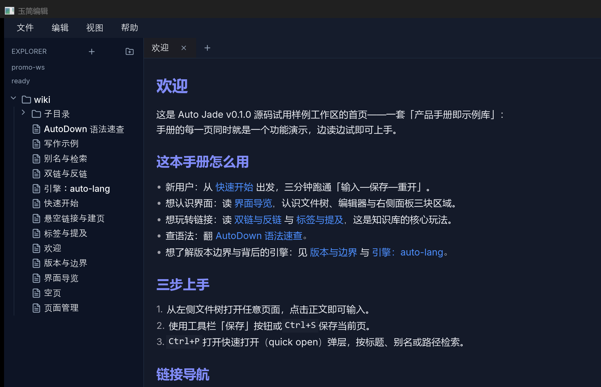
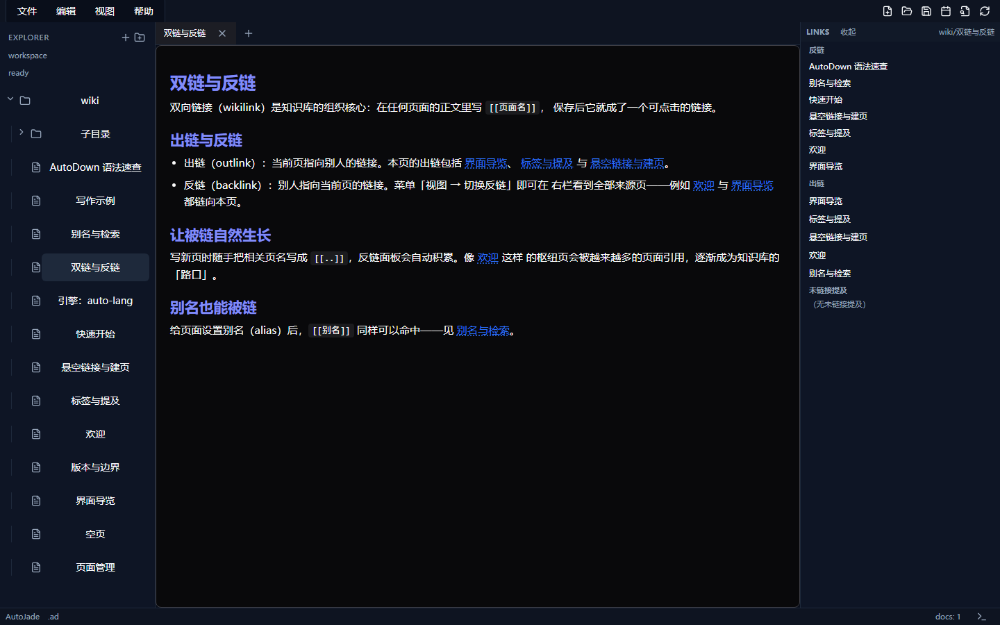
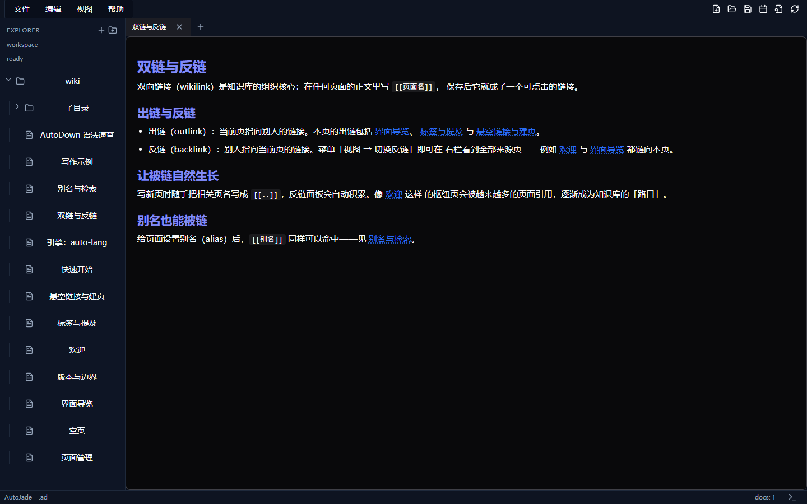
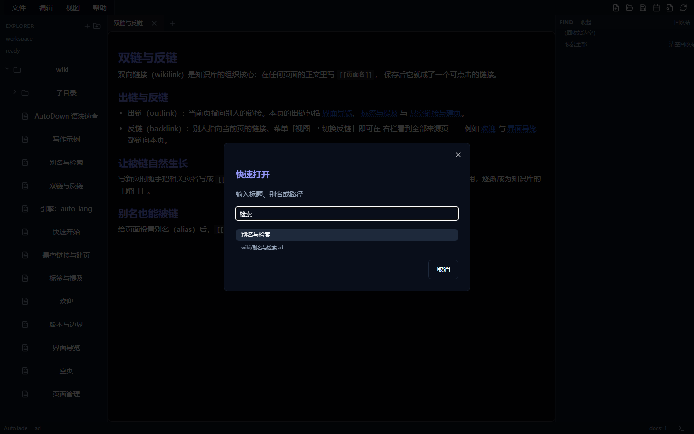
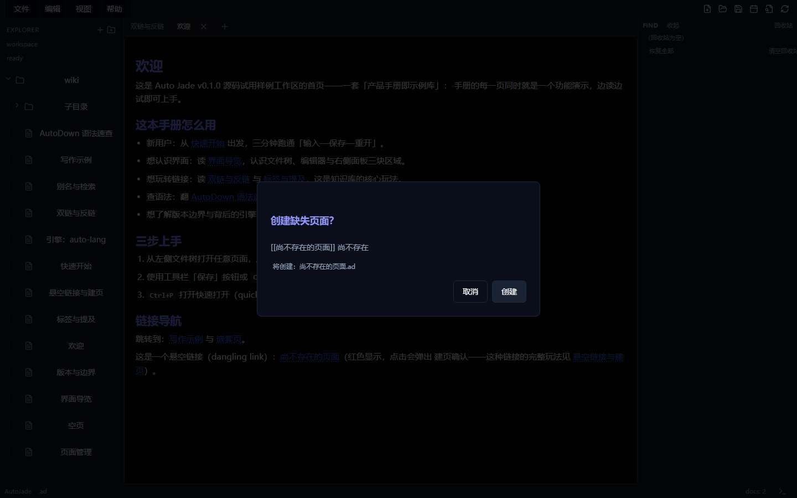
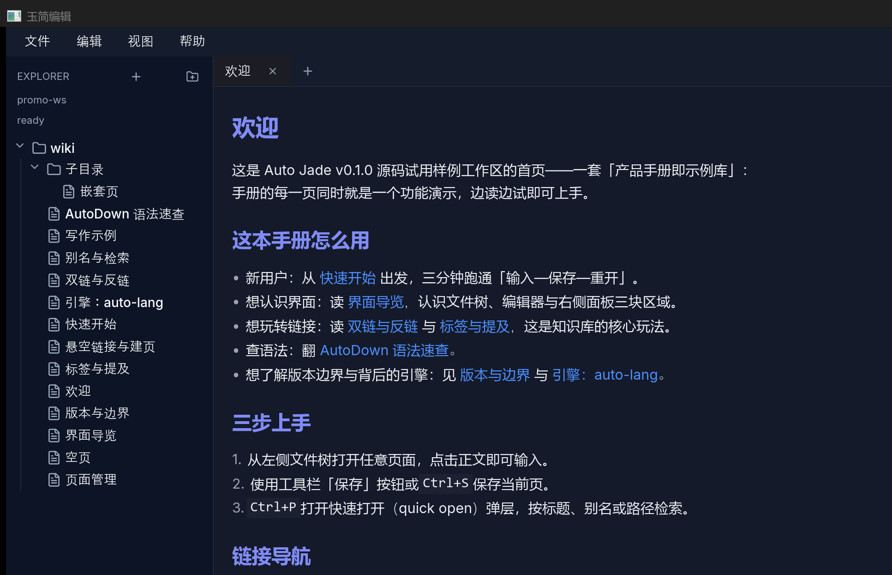

# AutoJade · 玉简编辑

**写好文档，连接页面，整理自己的本地知识库。**

[English](README.md) · [示例知识库](docs/releases/v0.1.0-rc/sample-workspace/wiki/欢迎.ad) · [开发文档](docs/README.md) · [发布状态](docs/RELEASE.md)

AutoJade 是面向 AutoDown（`.ad`）文档和本地知识库的编辑器，将文档写作、页面链接、反链、检索、标签和文件整理放进同一个工作区。页面保存在本地文件中，目录用于分组，元数据用于设置标题、别名和标签。

产品与源码工程现名为 **AutoJade / auto-jade**，本仓库暂沿用 **jade-edit** 名称。AutoJade 与 AutoEdit 是长期并存的独立应用：AutoEdit 侧重代码与文本编辑，AutoJade 侧重写作和知识关系。

[](docs/images/auto-jade/p1-main-dark.png)

*第一方产品手册在原生桌面窗口中的实际画面，原图与 AutoLang 网站共享。以下六张截图于 2026-10-10 提供，用于发布准备展示，不代替最终发行验收；点击图片可查看原图。[图片来源](docs/images/auto-jade/SOURCES.md)。*

## 从一篇文档到相互连接的知识

先打开一页，写下内容并保存。发现相关主题时，用 `[[页面名]]` 将它们连起来，查看哪些页面引用了当前页，再通过快速打开、标签或全文检索找回资料。

| 能力 | 可以做什么 |
|---|---|
| 文档与多标签 | 编辑 `.ad` 页面中的标题、段落、列表、代码块和 YAML 元数据，同时打开多篇文档 |
| 页面链接与反链 | 顺着相关页面阅读，查看入链、出链和未链接提及 |
| 悬空链接 | 汇集尚未写出的页面，通过确认弹层创建目标页 |
| 快速打开与检索 | 用 `Ctrl+P` 按文件名、显示标题、别名或路径找页；另有正文全文检索入口 |
| 标签与页面属性 | 浏览元数据标签和行内标签，编辑显示标题、别名与标签 |
| 每日笔记与最近打开 | 创建今日笔记，跨会话返回近期页面 |
| 文件与目录 | 新建、改名、移动和删除页面及目录，从回收站恢复误删页面 |
| 草稿保护 | 为未保存内容建立本地检查点，重启后恢复为独立副本 |

### 看看实际知识工作流

<details>
<summary>页面链接与反链</summary>

手册中的“双链与反链”页连接其他主题，右侧反链面板列出引用它的来源页；第二张图展示正文中高亮的页面链接。

[](docs/images/auto-jade/p2-backlinks-dark.png)

[](docs/images/auto-jade/p3-wikilink-dark.png)

</details>

<details>
<summary>查找页面与创建缺失目标</summary>

快速打开输入“检索”，可以通过别名找到“别名与检索”页。这是名称与别名查找，全文检索有独立入口。点击手册中的悬空链接会弹出建页确认，取消后文件保持原样。

[](docs/images/auto-jade/p5-quick-open-dark.png)

[](docs/images/auto-jade/p6-dangling-create-dark.png)

</details>

<details>
<summary>用目录组织页面</summary>

示例库的 `wiki/子目录/` 下有一篇嵌套页。页面仍是普通本地文件，也可以在应用之外查看。

[](docs/images/auto-jade/p7-filetree-dark.png)

</details>

## 在示例知识库里学习

随源码提供的[示例工作区](docs/releases/v0.1.0-rc/sample-workspace/)是一套 **14 页“产品手册即示例库”**：每页介绍功能，也用真实链接、别名、标签和嵌套目录演示功能。库中故意保留一处悬空链接，供你体验建页流程。手册目前为中文。

| 从这里开始 | 可以体验什么 |
|---|---|
| [欢迎](docs/releases/v0.1.0-rc/sample-workspace/wiki/欢迎.ad) · [快速开始](docs/releases/v0.1.0-rc/sample-workspace/wiki/快速开始.ad) | 打开页面、输入、保存，再重开验证 |
| [界面导览](docs/releases/v0.1.0-rc/sample-workspace/wiki/界面导览.ad) | 认识文件树、文档标签、编辑器与右侧面板 |
| [双链与反链](docs/releases/v0.1.0-rc/sample-workspace/wiki/双链与反链.ad) · [标签与提及](docs/releases/v0.1.0-rc/sample-workspace/wiki/标签与提及.ad) | 建立链接并浏览知识关系 |
| [别名与检索](docs/releases/v0.1.0-rc/sample-workspace/wiki/别名与检索.ad) · [悬空链接与建页](docs/releases/v0.1.0-rc/sample-workspace/wiki/悬空链接与建页.ad) | 找回已有页面，发现接下来要写的内容 |
| [页面管理](docs/releases/v0.1.0-rc/sample-workspace/wiki/页面管理.ad) · [AutoDown 语法速查](docs/releases/v0.1.0-rc/sample-workspace/wiki/AutoDown%20语法速查.ad) | 整理文件，熟悉写作格式 |
| [版本与边界](docs/releases/v0.1.0-rc/sample-workspace/wiki/版本与边界.ad) | 了解源码试用版的范围 |

试用前先复制示例库。第一次可以打开“写作示例”，写一段文字，通过工具栏、文件菜单或 `Ctrl+S` 保存，再重开确认；随后打开“欢迎”，沿页面链接阅读、查看反链，并点击“尚不存在的页面”体验悬空建页。

## 页面名称、文件操作与未保存内容

显示标题、文件名和别名承担不同职责，快速打开可以匹配三者。页面链接通过文件名与别名解析，单独修改显示标题不会改变链接身份。

页面重命名会更新匹配的引用；只移动目录位置而不改变文件名时，链接继续有效，无需改写。删除页面会将文件移入回收站，让原有入链变为悬空；恢复页面后，这些链接可重新接通。

应用内文件操作会检查受影响的打开文档；它们有未保存修改或需要核对时，操作会先阻断。手动重载也会保护未保存内容。本地草稿检查点提供恢复机会，但 **“草稿已保护”不等于“文档已保存”**：恢复先打开独立副本，不直接覆盖原文件。具体规则见[文件操作保护](docs/specs/document-lifecycle.md)和[草稿恢复](docs/specs/draft-recovery.md)。

## 从源码运行

当前 **v0.1.0 是处于发布准备阶段的 Windows 源码试用里程碑**，需要匹配的 Auto 工具链和兄弟仓依赖，暂不提供独立安装包。最终候选与验证状态见[发布文档](docs/RELEASE.md)和[试用指南](docs/releases/v0.1.0-rc/trial-guide.md)。

将仓库放在如下相邻目录中；当前保留 `jade-edit` 目录名：

```text
workspace/
├── jade-edit/   # AutoJade，本仓库
├── auto-lang/  # Auto 工具链与共享蓝图
├── auto-edit/  # 共享样式组件
└── auto-down/  # AutoDown 编辑器包
```

Vue 形态需要 Node.js、pnpm 和已构建的 AutoDown 引擎，构建脚本会检查引擎产物是否新鲜。在 `jade-edit` 根目录设置实际工具链和引擎路径后构建：

```powershell
$env:AUTO_EXE = (Resolve-Path '..\auto-lang\target\debug\auto.exe').Path
$env:AUTO_JADE_ENGINE_ROOT = (Resolve-Path '..\auto-down\autodown\packages\engine').Path
& $env:AUTO_EXE --version
pnpm install
pnpm build
```

示例使用本地构建的 debug 工具链；冻结版试用应改用发布资料指定的工具链并核对指纹。

复制手册到新目录，并显式选为工作区：

```powershell
$taskWiki = Join-Path $env:USERPROFILE ('auto-jade-manual-' + (Get-Date -Format 'yyyyMMdd-HHmmssfff'))
Copy-Item -LiteralPath '.\docs\releases\v0.1.0-rc\sample-workspace' -Destination $taskWiki -Recurse
$env:AUTO_JADE_WORKSPACE = $taskWiki

# 原生桌面窗口
& $env:AUTO_EXE run -r vm --theme dark
```

也可以启动浏览器界面与配套应用后端：

```powershell
& $env:AUTO_EXE run -r vue --server vm -B 8211 -F 4443
```

打开 <http://127.0.0.1:4443>。两种形态都应显式设置 `AUTO_JADE_WORKSPACE`。Vue 界面的读写、检索与保存依赖后端，单独托管生成后的静态界面不能提供这些操作。

## 当前范围与后续方向

两种形态共用 Auto 应用与界面源码：AutoVM/AutoUI 渲染原生窗口，生成路径构建 Vue 3 + Vite 浏览器界面。AutoDown 提供文档与编辑器基础，AutoEdit 提供共享样式组件；旧 Jade Garden 是功能与设计参考。同源开发不自动保证每个运行环境都有完全相同的体验。

源码试用以 **不超过 200 页**的工作区为目标，名称匹配覆盖 **8 层目录**；超规模时会提示。部分含 Shift 的快捷键目前需用菜单替代；刚输入的页面链接文本不会立即变成可点击链接；开页也不会把光标定位到块锚点。原生空页输入仍是用户试用核验项。完整限制和走查步骤见[试用指南](docs/releases/v0.1.0-rc/trial-guide.md)。

近期重点是写作体验与可靠的文档操作。图谱、大纲、自动保存与版本历史、协作、更深入的 AI 知识工作流及安装包属于后续方向，不作为当前版本承诺。

实现细节见[开发概览](docs/README.md)、[架构](docs/ARCHITECTURE.md)和[模块规范](docs/specs/)。本介绍于 2026-10-11 对照仓库现状与网站内容核对。
